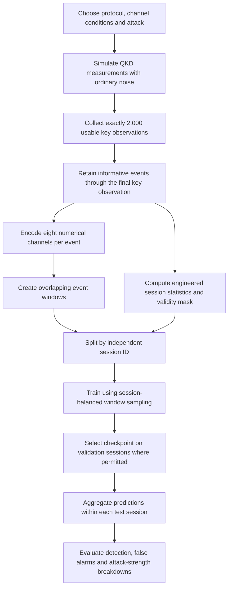
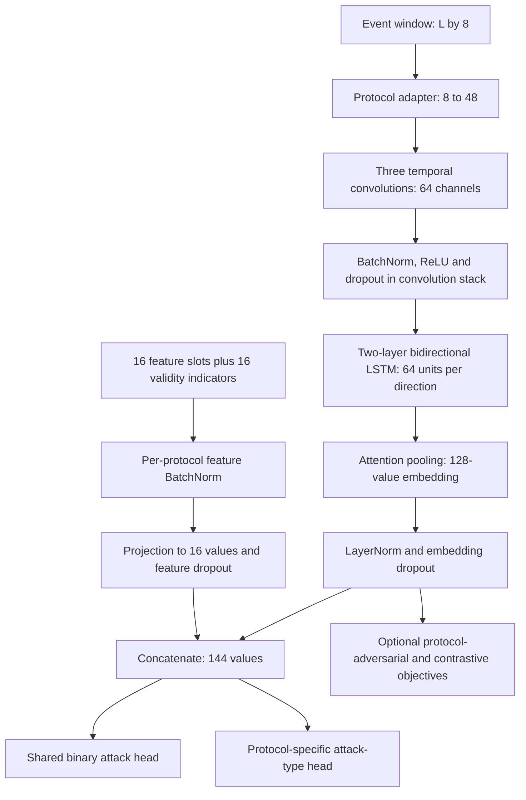

# Deep Learning for QKD: Pipeline, Training Updates and Validation

**Implementation:** `changed.py`  
**Revision date:** 27 October 2026  
**Protocols:** BB84, BKM07 and E91

## 1. Purpose and current status

The deep-learning (DL) system learns to distinguish honest QKD sessions from sessions affected by a simulated attack. It also supports protocol-specific attack classification, transfer between protocols, and experiments with previously unseen attacks.

This revision addresses insufficient training budgets, inconsistent regularisation, unequal contributions from sessions, and a mismatch between window-level checkpoint selection and session-level evaluation. The models are still classical PyTorch neural networks: quantum behaviour is simulated first, and the networks process the resulting numerical observations.

**The updated code executes and learns in controlled tests. A universal improvement in QKD detection accuracy has not been established.** The small before/after experiment showed improvements for some protocols and regressions for others. Section 11 records these results and their limits. The default regularisation values are conservative starting settings, not a completed hyperparameter optimisation.

The primary code to run is `changed.py`. Its physics simulation remains the source of both clean and attacked examples. The pre-edit implementation is retained in `documentation_work/dl_regularization/baseline_changed.py` for comparison.

## 2. End-to-end pipeline



### 2.1 What constitutes one session?

A session is one independently generated QKD run. The main datasets collect **K = 2,000 usable key observations**. This does not mean every session contains exactly 2,000 raw transmissions or exactly 2,000 encoded events. Loss and protocol-specific monitoring requirements affect those counts.

The simulator retains the informative observations up to the K-th usable key observation. It then calculates both the event sequence and engineered features from that record.

### 2.2 Protocol-specific observations and tasks

| Protocol | Events used by DL | Attack labels in the main DL taxonomy | Useful evidence |
|---|---|---|---|
| BB84 | Detector clicks, including signal, decoy and vacuum observations | Clean, intercept-resend, PNS, blocking, loss manipulation | Errors, intensity-dependent behaviour, event gaps and session detection statistics |
| BKM07 | Survived round trips, including SIFT and CTRL observations | Clean, symmetric interception, asymmetric interception | Key errors, monitor/CTRL errors, forward/return effects and event gaps |
| E91 | Measured entangled-pair outcomes | Clean, intercept-resend, ancilla, extra depolarisation | Key errors, measurement settings and CHSH correlations |

Clean sessions still contain the ordinary noise implemented by the simulator. The target label comes from the selected attack condition, rather than a threshold applied to the observed QBER.

### 2.3 Eight event channels

| Channel | Interpretation |
|---|---|
| `kept` | Whether the event contributes to the usable key |
| `error` | The protocol-appropriate error indicator; its precise meaning depends on the round type |
| `basis_a` | Alice's basis or measurement setting, scaled numerically |
| `basis_b` | Bob's basis or setting; BKM07 uses a designated value when a basis is not applicable |
| `test_flag` | Whether this is a dedicated test/monitoring category |
| `event_gap` | Log-compressed gap between informative events, carrying information about loss/detection rate |
| `aux1` | Intensity category, BKM07 round type, or E91 setting category |
| `chsh_running` | Running E91 CHSH estimate; zero for the other protocols |

These channels share a tensor layout, but their meanings are not identical across protocols. Protocol-specific adapters help account for that difference.

### 2.4 Window construction and session splitting

The usual window length is 96 events and the stride is 48. The final tail window is included so observations through the K-th key event are available. BB84's architecture study also evaluates 192- and 384-event windows.

The usual sequence tensor has shape:

`[number of windows, 96 events, 8 channels]`

All windows from a session stay in one split. `session_split()` normally allocates 70% of sessions to training, 10% to validation and 20% to testing, with stratification when the class counts permit it. Some experiments explicitly request different proportions. An overlap audit verifies that session IDs are disjoint.

Overlapping windows are correlated examples. They increase the number of training inputs, but do not increase the number of independent sessions by the same factor.

## 3. Main model architecture

`CrossProtocolDetector` combines temporal observations with engineered session features.



Here, **L** is the number of events in one window. Default widths can be changed through the model constructor.

### 3.1 Feature extraction

1. **Adapters:** a Linear layer per protocol maps eight input channels to 48 latent values.
2. **Convolutions:** three one-dimensional convolutions use kernel sizes 5, 5 and 3, with dilations 1, 2 and 4. They identify local patterns at different temporal scales.
3. **Batch normalisation:** each convolution block normalises channel activations. ReLU supplies nonlinearity. The first two blocks retain dropout.
4. **Bidirectional LSTM:** two layers capture event relationships in both directions within an available window. Inter-layer dropout is applied during ordinary training.
5. **Attention:** learned scores determine how much each event contributes to the pooled embedding. An ablation can replace this with average pooling.
6. **New embedding normalisation/dropout:** LayerNorm controls the scale of the pooled representation, and dropout reduces reliance on individual embedding components.

A bidirectional window model requires the complete window before producing its prediction. It is not a causal prediction at each individual event.

### 3.2 Engineered-feature branch

The code reserves 16 feature slots and supplies 16 validity indicators. Shorter protocol-specific feature lists are padded. The mask distinguishes an unavailable feature from a real numerical zero.

In the main detector, protocol-specific BatchNorm operates on the feature values. The normalised values are clipped, masked, joined with their validity indicators and projected to 16 values. The new feature dropout acts on this projection before fusion.

In the architecture benchmark, feature scaling is fitted using training data only. The revised scaling weights sessions equally. `Full+feat` additionally retains its internal protocol-specific feature normalisation.

The complete session feature vector is repeated across that session's windows. Consequently, the `+feat` results describe decisions using full-session information. They should not be presented as early alarms based solely on the first few events.

### 3.3 Outputs and auxiliary objectives

- **Binary detection:** clean versus attacked, using binary cross-entropy on logits.
- **Attack classification:** a separate head for each protocol, using weighted multiclass cross-entropy.
- **Protocol-adversarial learning:** a discriminator predicts protocol identity. Gradient reversal encourages the shared sequence representation to contain less protocol-specific information.
- **Supervised contrastive learning:** encourages embeddings with the same binary label to be closer. This is enabled in designated mixed-protocol experiments.
- **Deep SVDD:** a separate bias-free encoder learns a compact representation of clean sessions for anomaly detection. It retains its own objective and architectural restrictions.

The LSTM autoencoder defined in the source remains an extension point; it is not the primary detector in the main training flow.

## 4. Changes made and their rationale

| Area | Previous behaviour | Revised behaviour | Reason |
|---|---|---|---|
| Epoch budget | Usually 10–30 epochs, depending on the experiment/profile | Higher profile budgets, shown in Section 6 | Give slower learners more optimisation steps |
| Early stopping | Best checkpoint saved, but all epochs executed | Patience-based stopping and best-checkpoint restoration where permitted | Stop when validation performance ceases to improve |
| L1 regularisation | No explicit L1 penalty | Small configurable mean-absolute-weight penalty on trainable Linear/Conv1d weights | Discourage unnecessarily large or redundant weights |
| AdamW | Uniform weight decay over trainable parameters | Decay matrix weights; exclude biases and normalisation vectors | Avoid shrinking parameters whose role is centring/scaling activations |
| Main fusion | No dropout on the final sequence embedding or feature projection | Configurable embedding and feature dropout | Reduce dependence on individual fused components |
| Recurrent comparison models | Little explicit output regularisation | LayerNorm and dropout before their output layer | Stabilise representation scale and limit overfitting |
| CNN–LSTM comparison | Single convolution without BatchNorm/dropout | Convolution block gains BatchNorm, ReLU and dropout | Improve conditioning and regularise temporal features |
| Transformer comparison | Internal dropout fixed at 0.1 | Configurable internal dropout, default 0.2, plus output dropout | Make regularisation explicit and adjustable |
| Session influence | Sessions with more windows contribute more updates | Optional inverse-window-count sampling, enabled by default | Give independent sessions equal expected influence |
| Class weighting | Main trainer uses window counts; benchmark binary loss is unweighted | Session-weighted class counts; benchmark gains weighted binary loss | Account for class imbalance at the session level |
| Benchmark selection | Best validation window AUC | Best validation session AUC, with validation-loss tie breaking | Match selection to the reported session-level decision |
| Multiclass evaluation | Window-level hard predictions | Average probabilities within sessions when IDs are available | Evaluate independent sessions consistently |
| Benchmark device | CPU-only training and unbatched validation | Selected CPU/CUDA device and batched validation/inference | Use available acceleration and reduce peak inference memory |
| Diagnostics | Limited epoch information | Per-fit JSON histories, epoch counts and attack-strength reports | Make underfitting, stopping behaviour and weak-attack failures visible |
| Invalid validation | Main binary trainer could silently fall back from AUC to F1 | Undefined validation AUC produces a clear error | Avoid selecting models using a different metric unexpectedly |

Gradient clipping at norm 1.0 and cosine learning-rate scheduling remain in use. The multiclass trainer now also has a cosine schedule. The architecture benchmark's default initial learning rate is reduced from 0.002 to 0.001 for more gradual updates over the longer budget.

## 5. Regularisation mathematics

### 5.1 Classification and L1 penalty

For supervised binary training, the basic objective is:

\[
L_{\mathrm{total}}=L_{\mathrm{BCE}}+\lambda_1\frac{1}{M}\sum_{j=1}^{M}|w_j|.
\]

The weighted binary classification term is:

\[
L_{\mathrm{BCE}}=-\frac{1}{B}\sum_{i=1}^{B}
\left[a\,y_i\log(p_i)+(1-y_i)\log(1-p_i)\right],
\qquad p_i=\sigma(z_i).
\]

| Symbol | Meaning |
|---|---|
| `L_total` | Training objective before optional adversarial/contrastive additions |
| `L_BCE` | Binary cross-entropy classification loss |
| `lambda_1` | L1 coefficient; default `1e-4` |
| `M` | Number of selected trainable Linear/Conv1d weight elements |
| `w_j` | One selected weight element |
| `B` | Number of windows in the minibatch |
| `y_i` | True binary label: 0 for clean, 1 for attacked |
| `z_i` | Model logit before the sigmoid |
| `p_i` | Sigmoid output for window i |
| `sigma` | Sigmoid function, `1 / (1 + exp(-z))` |
| `a` | Positive-class weight, calculated from training data as clean weight divided by attacked weight |

This is a **Lasso-style L1 penalty**, rather than a separate Lasso regression model. Averaging over selected elements prevents the penalty magnitude from simply growing with model width. It encourages smaller weights; AdamW training with this penalty does not guarantee exact zero coefficients or automatic feature selection.

The explicit L1 penalty excludes recurrent gate matrices, biases, normalisation parameters and frozen weights. It applies to the main supervised binary/multiclass trainers and the architecture benchmark. Deep SVDD keeps its clean-distance objective and smaller `1e-5` weight decay; it does not receive the new supervised L1 penalty.

AdamW applies its weight decay through the optimiser update, rather than by adding an L2 term to the loss expression above.

### 5.2 Dropout

During training, an activation is transformed as:

\[
\widetilde{h}=\frac{m h}{1-d},\qquad m\sim\mathrm{Bernoulli}(1-d).
\]

`h` is an activation, `h_tilde` is its training-time output, `d` is the probability of dropping it, and `m` is a random keep indicator. The scaling preserves its expected value. Dropout is disabled for evaluation.

Default `dropout=0.2` controls the relevant sequence/model blocks. Default `fusion_dropout=0.15` controls the added embedding/output/feature-fusion dropout. The two-layer main LSTM has genuine inter-layer dropout. The single-layer comparison LSTMs use dropout after their representations; setting an LSTM inter-layer dropout argument on a single-layer LSTM would not provide that effect.

### 5.3 BatchNorm and LayerNorm

Both can be represented schematically as:

\[
\widehat{x}=\gamma\frac{x-\mu}{\sqrt{v+\epsilon}}+\beta.
\]

`x` is an input activation, `mu` its normalisation mean, `v` its variance, `epsilon` a small stabilising constant, and `gamma` and `beta` learned scale and offset parameters.

BatchNorm uses batch/channel statistics during training and running statistics during evaluation. LayerNorm normalises within each individual representation and therefore does not require reliable minibatch statistics. The revised main model uses LayerNorm on the pooled sequence embedding, while retaining BatchNorm where the CNN already uses it.

The main engineered-feature BatchNorm still has a singleton-batch fallback. It uses stored statistics when a protocol contributes only one example to a training batch.

### 5.4 Session-balanced sampling

If session `s` contributes `n_s` windows, each of its windows receives sampling weight proportional to:

\[
u_i=\frac{N}{S\,n_s}.
\]

`u_i` is the weight of window i, `N` is the total number of training windows, and `S` is the number of training sessions. All weights within one session sum to `N/S`.

Sampling is performed with replacement. A training epoch still draws `N` windows; equal session contribution is an expectation, not an exact count guarantee in each epoch. Validation and testing retain their original deterministic order.

### 5.5 Session-level checkpoint selection

The architecture benchmark averages window logits:

\[
z_s=\frac{1}{n_s}\sum_{i\in s}z_i.
\]

`z_s` is the session score, `z_i` a window logit, and `n_s` the number of windows in session s. It computes validation AUC from these session scores. The main cross-protocol evaluator retains its existing convention of averaging window probabilities; selection and evaluation use that same convention within that path.

Binary checkpoint selection first looks for an AUC increase greater than `min_delta`. When AUC is within that tolerance of the best score, a sufficiently lower validation binary cross-entropy also counts as an improvement. Multiclass selection uses session macro-F1 and a cross-entropy tie breaker. SVDD monitors clean validation distance.

The default patience is 10 non-improving epochs, with at least 10 epochs before stopping is allowed. If the configured budget is smaller, training simply reaches that budget. The best permitted checkpoint is restored at the end.

Training loss may include class weighting and auxiliary objectives, whereas validation loss is calculated from validation predictions. Their numerical scales are therefore not necessarily identical; use the validation trajectory and task metrics when interpreting overfitting.

## 6. Increased epoch budgets

| Training stage | Quick | Standard | Large (default profile) | XL |
|---|---:|---:|---:|---:|
| Source-protocol pretraining | 3 | 60 | 80 | 120 |
| Target fine-tuning | 3 | 30 | 40 | 60 |
| Grouped CV / primary fine-head and diagnostic training | 3 | 40 | 60 | 80 |
| Final architecture comparison | 3 | 60 | 80 | 120 |

For reference, large-profile pretraining and final comparison previously used 20 epochs; target fine-tuning and grouped CV used 15. The primary multiclass and embedding diagnostic calls now follow the profile instead of retaining fixed 15-epoch calls.

The quick profile is an execution check. Three epochs and small datasets cannot support claims about final model quality. The standard, large and XL budgets are upper bounds when early stopping is enabled.

### 6.1 Why some training still uses a fixed budget

Certain transfer and scratch comparisons explicitly set `select_best=False`. Their target-label budget rules disallow using target validation labels to choose an epoch. Those calls continue for their prescribed epoch count, record training history and return the final epoch. They do not use validation-based early stopping or checkpoint selection.

Frozen CNN/LSTM/attention parameters remain frozen during transfer. The added embedding LayerNorm is also frozen, and its embedding dropout is disabled with the trunk. CNN BatchNorm running statistics stay fixed. The frozen LSTM's inter-layer dropout is set to zero while its training mode is retained where needed for CUDA backpropagation to the input adapter.

## 7. Configuration

The settings are validated by `dl_training_config()`:

| Setting | Default | Function |
|---|---:|---|
| `dropout` | 0.2 | Drop probability in applicable model blocks |
| `fusion_dropout` | 0.15 | Drop probability in added embedding/fusion/output branches |
| `layer_norm` | true | Enable the newly added pooled/output LayerNorm |
| `l1` | 0.0001 | Coefficient of mean absolute selected weights |
| `weight_decay` | 0.0001 | AdamW decay for eligible matrix weights |
| `patience` | 10 | Non-improving epochs allowed |
| `min_epochs` | 10 | Earliest epoch at which early stopping may trigger |
| `min_delta` | 0.0001 | Minimum improvement tolerance |
| `balanced_sessions` | true | Enable equal expected session contribution |
| `log_history` | true | Write per-training-run JSON histories |

Use `QKD_DL_CONFIG` to override only the desired fields. For example, in PowerShell:

```powershell
$env:QKD_DL_CONFIG = '{"dropout":0.15,"fusion_dropout":0.1,"l1":0.00001,"patience":12}'
python changed.py --profile standard --regenerate
```

These values are an example of a lighter regularisation experiment, not a validated improvement over the defaults. Choose settings using training/validation data and keep the final test set untouched.

To override epoch budgets without editing the code:

```powershell
$env:QKD_SC_OVERRIDE = '{"ep_pre":80,"ep_ft":40,"cv_epochs":60,"s24_dl_epochs":80}'
python changed.py --profile standard --regenerate
```

To return to defaults:

```powershell
Remove-Item Env:QKD_DL_CONFIG -ErrorAction SilentlyContinue
Remove-Item Env:QKD_SC_OVERRIDE -ErrorAction SilentlyContinue
```

The transfer and CV checkpoint fingerprints now include the regularisation configuration, so a changed setting does not silently reuse incompatible completed results. Training histories also record their configuration and code version.

## 8. Running the updated implementation

Run commands from the directory containing `changed.py`, using the Python environment with the project's scientific dependencies and PyTorch installed.

```powershell
# Small execution check; does not establish model accuracy.
python changed.py --profile quick --regenerate

# Larger experiment with the revised training settings.
python changed.py --profile standard --regenerate
```

`--regenerate` uses a fresh output directory beneath `qkd_runs`, retaining earlier outputs. The script includes simulation, classical ML and other analysis sections before and after DL. These commands run the complete study, not only a neural-network training loop. Larger profiles can require substantial compute.

The final architecture trainer now follows `DL_DEVICE`, which chooses CUDA if available and CPU otherwise. This change was tested on CPU in this environment. CUDA execution still needs verification on a CUDA-enabled installation.

## 9. Outputs and interpretation

### 9.1 Training histories

Each logged fit writes a uniquely named JSON file under:

`data/dl_training_history/`

The file contains the trainer name, configuration, code version, epochs run, selected epoch and per-epoch training loss, learning rate and validation metrics where selection is allowed. The in-memory trained model exposes `training_history_` and `training_summary_`; the benchmark prediction function exposes the same information.

The final comparison table gains `epochs_run`, `selected_epoch`, `regularization` and threshold-based `accuracy` for neural models. A history records diagnostics; it is not a serialised model checkpoint for later deployment.

### 9.2 Attack-strength diagnostics

The architecture benchmark writes:

`data/dl_attack_diagnostics_<protocol>_L<window>_seed<seed>.csv`

For each observed attack type, it reports all strengths together and fixed bands:

- Weak: `0 < strength <= 0.1`.
- Moderate: `0.1 < strength <= 0.4`.
- Strong: `strength > 0.4`.

Each row reports attack counts, honest-session counts, attack-versus-clean AUC, recall and false-positive rate. The threshold is the same frozen threshold calibrated on validation clean sessions at the nominal 1% false-positive operating point. These bands describe the simulator's attack parameter; their physical effect differs between attack mechanisms.

This output helps distinguish a general learning failure from a model that detects strong attacks but struggles near the noise floor. Small sample counts make these subgroup estimates uncertain. A nominal validation 1% target is not a guarantee of a 1% deployment false-positive rate.

### 9.3 Recommended interpretation of existing metrics

| Metric | Meaning |
|---|---|
| Session ROC-AUC | Ranking of attacked sessions above clean sessions; random ranking has expected AUC 0.5 |
| PR-AUC | Precision/recall ranking; its baseline depends on attack prevalence |
| Recall at configured FPR | Fraction of attacks detected at a validation-calibrated operating threshold |
| Accuracy | Fraction of correct thresholded decisions; depends on prevalence and threshold |
| Macro-F1 | Equal-weight average of per-class F1 for attack classification |

Random guessing does not universally mean 50% accuracy. The benchmark's balanced session setup differs from the main dataset, which has one clean class and several attack classes. Always compare to the appropriate prevalence baseline and inspect false alarms and missed attacks separately.

## 10. Verification performed

The tests extract definitions from `changed.py` so they can exercise the implementation without running the complete simulation study.

1. Existing regression suite: 43 checks covering protocol simulation, exact-K collection, group isolation, feature masks, model variants, transfer/ablation paths and result provenance.
2. New focused tests: 26 checks covering optimiser parameter groups, L1 gradient targets, equal session weights, early stopping and checkpoint restoration, frozen weights/BatchNorm/dropout, all 12 architecture variants, singleton inference, session-level scoring, multiclass training, report exports and overlap rejection.
3. Learnability control: independent synthetic sessions with an intentionally clear signal. With 60 epochs and minibatches of 16, the MLP with features achieved test AUC 1.0. An initial 20-epoch test used only one minibatch per epoch and achieved about 0.79; the training curve was still improving. This supports allowing more optimisation steps, but does not establish QKD performance.
4. Physics-derived comparison: the pre-edit and updated `Full+feat` models received identical simulated QKD sessions and identical session splits. Results are shown below.

Verification files are under `documentation_work/dl_regularization/`. The additional regression runner is `verify_dl.py`; its `--benchmark` option reproduces the small comparison. It reuses the existing local test dependency setup. The complete production study has not been rerun at the enlarged epoch budgets.

## 11. Small before/after comparison

The diagnostic uses 48 sessions per protocol: 24 clean, 12 stronger attacks at strength 0.6, and 12 weak attacks at strength 0.03. Each session has K = 256 usable key observations. BB84/E91 use intercept-resend and BKM07 uses symmetric interception. The BB84 distance range is 0–10 km and BKM07 uses 0–3 km. It uses two split/initialisation seeds, with 24 training, 12 validation and 12 test sessions per split.

The baseline has a 12-epoch budget. The updated model has a 30-epoch budget with early stopping, so this is a comparison of the combined training changes, not an isolated regularisation ablation. The production settings remain K = 2,000 and the larger budgets in Section 6.

| Protocol | Mean baseline session AUC | Mean updated session AUC | Observed change |
|---|---:|---:|---:|
| BB84 | 0.8194 | 0.7778 | -0.0417 |
| BKM07 | 0.8056 | 0.8333 | +0.0278 |
| E91 | 0.5000 | 0.5694 | +0.0694 |

These are descriptive means over two small, overlapping dataset splits. They do not establish statistical significance. No settings were selected by searching these test results. Strong attacks were generally much easier to rank than weak attacks. Individual weak-attack results varied widely, and one E91 split remained at AUC 0.5 overall.

The raw per-seed results are in `documentation_work/dl_regularization/benchmark_results.json`. The diagnostic supports that the implementation trains and that performance depends strongly on the protocol and attack strength. It does **not** justify claiming that the new default configuration improves every protocol or that weak-attack detection is solved.

## 12. Remaining limitations and next experiments

1. **Weak attacks may overlap ordinary noise.** The main dataset samples strengths log-uniformly between 0.01 and 1.0. Half of this range's probability mass lies between 0.01 and 0.1. Many labelled attacks therefore produce subtle changes. Additional epochs cannot create information that is absent from the observations.
2. **Some physical conditions are observationally similar.** For example, changes to an E91 state from ordinary visibility reduction and extra depolarisation can overlap. Performance limits must be assessed with the actual measured features and noise conditions.
3. **Simulation coverage is limited.** The main DL builders do not automatically inherit all noise variations used in separate robustness experiments. Evaluate ordinary drift, detector variation and channel shifts before treating the model as ready for real hardware.
4. **Shared-model transfer can cause negative transfer.** Protocol-adversarial and contrastive objectives are useful hypotheses, not guaranteed improvements. Compare their existing ablations on source/validation data.
5. **Small validation sets make selection noisy.** Increase independent sessions when confidence intervals remain wide. Adding overlapping windows alone does not resolve this.
6. **Over-regularisation can reduce accuracy.** If both training and validation performance are poor, test lower dropout/L1 on validation data and compare with simpler models. The updated defaults should not replace this check.
7. **Accuracy claims require a larger matched evaluation.** Run the standard or larger profile, report results by protocol/attack/strength, and compare against the existing engineered-feature-only baseline on the same held-out sessions. A separate validation-only hyperparameter search and final untouched test evaluation are the next steps for establishing robust efficacy gains.

## 13. Implementation map

| Function or class in `changed.py` | Responsibility |
|---|---|
| `_bb84_dl_session`, `_bkm07_dl_session`, `_e91_dl_session` | Generate protocol-specific event records and same-session engineered features |
| `encode_session`, `make_windows` | Build event tensors and overlapping windows |
| `build_dl_dataset`, `build_sessions` | Assemble the two main DL experiment datasets |
| `session_split` | Keep independent sessions disjoint across splits |
| `dl_training_config` | Validate configurable regularisation controls |
| `_dl_optimizer`, `_dl_l1` | Apply selective weight decay and the explicit L1 penalty |
| `_dl_session_weights`, `make_dl_loader` | Implement equal expected session influence |
| `DLTrainingMonitor` | Record history, stop on a validation plateau and restore the checkpoint |
| `CrossProtocolDetector` | Main shared CNN–BiLSTM–attention model with feature fusion |
| `train_binary`, `train_fine`, `train_svdd` | Train the different objectives under their evaluation rules |
| `evaluate_binary`, `evaluate_fine` | Calculate predictions and aggregate by session when IDs are supplied |
| `fit_dl`, `run_dl` | Train and compare the per-protocol architecture variants |
| `dl_attack_diagnostics` | Report where performance varies by attack type and strength |

